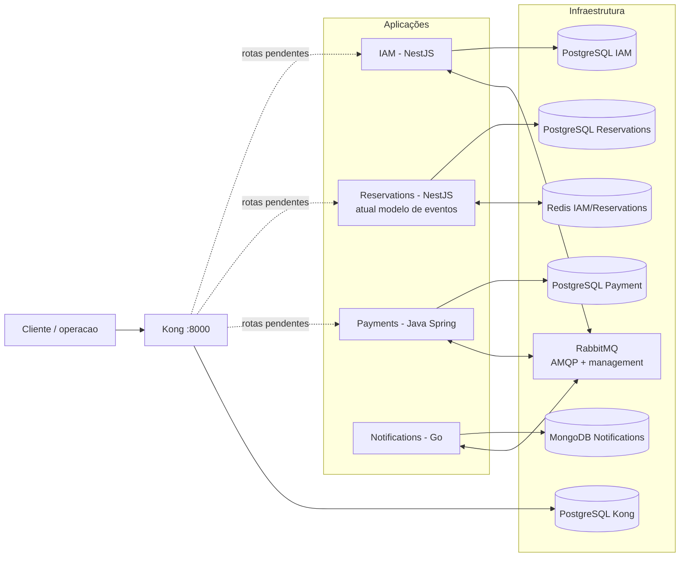
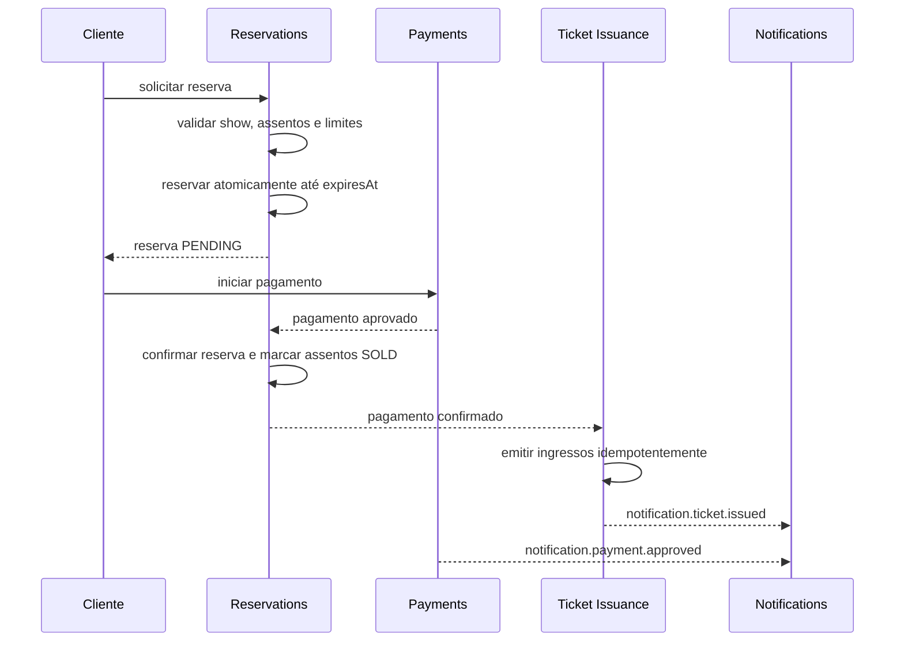

# FlashTicket

FlashTicket é um laboratório contínuo de engenharia de backend para modelar um
mercado de eventos e ingressos realista. O objetivo não é entregar um produto
comercial finalizado, mas construir evidências práticas sobre modelagem de
domínio, concorrência, consistência distribuída, mensageria, observabilidade e
arquiteturas poliglotas.

> Estado atual: laboratório em construção. Alguns componentes estão
> implementados ou parcialmente implementados; não há ainda um fluxo completo de
> compra ponta a ponta comprovado por testes.

## Problema de engenharia

Uma venda de ingressos combina restrições difíceis: estoque limitado, compradores
concorrentes, reservas temporárias, pagamento assíncrono, expiração, emissão
idempotente e notificações entregues pelo menos uma vez. A plataforma permite
experimentar essas preocupações sem fingir que elas desaparecem ao separar o
sistema em microsserviços.

## Objetivos do laboratório

- praticar DDD e separação de contextos delimitados;
- comparar soluções poliglotas com responsabilidades bem definidas;
- estudar concorrência otimista e controle atomico de estoque;
- experimentar RabbitMQ, idempotência, retries, DLQ e padrões de integração;
- evoluir leitura síncrona e assíncrona sem confundir CQRS com Event Sourcing;
- medir, em vez de presumir, cache, latência, throughput e contenção;
- produzir decisões arquiteturais rastreáveis e critérios de aceite verificáveis.

## Funcionalidades

| Área | Estado atual |
|---|---|
| IAM | PARCIAL: health check, estrutura NestJS e esqueleto de auth; sem cadastro, login ou políticas implementados |
| Events | PARCIAL: catálogo, show, setores, assentos, tipos, lotes e benefícios possuem modelo/migrations; controllers de domínio ainda não existem |
| Reservations | PARCIAL: entidades, migrações PostgreSQL e cálculo de preço existem; nenhum fluxo HTTP de reserva foi implementado |
| Payments | PARCIAL: aplicação Spring Boot, segurança fechada por padrão e health check; sem persistência ou pagamento funcional |
| Ticket Issuance | PARCIAL: entidade `Ticket` e unicidades existem no banco; emissão não possui fluxo implementado |
| Notifications | IMPLEMENTADO como serviço independente: ingestão RabbitMQ, persistência MongoDB, SSE, emails Resend e health check |
| API Gateway | PARCIAL: Kong e banco próprio definidos, mas sem rotas de aplicação configuradas |
| EDA/CQRS/Event Sourcing | PLANEJADO; no momento existe consumo RabbitMQ no serviço de notificações |

## Arquitetura atual efetiva



O diagrama acima descreve o que está configurado no repositório. Redis aparece
como dependência de infraestrutura, mas a decisão sobre seu uso como cache ou
estado temporario ainda não possui implementação pública que justifique uso
como fonte de verdade.


## Stack tecnológica efetivamente utilizada

| Componente | Tecnologia |
|---|---|
| IAM | NestJS 11, TypeScript 5, PostgreSQL, Redis provisionado |
| Reservations/Events | NestJS 11, TypeORM, PostgreSQL, Redis provisionado |
| Payments | Java 25, Spring Boot 4.1.2, JPA, Flyway, PostgreSQL, RabbitMQ |
| Notifications | Go 1.25, RabbitMQ, MongoDB, Resend |
| Gateway | Kong 3.9.4, PostgreSQL 17 |
| Infra | Docker Compose, RabbitMQ 4, PostgreSQL 17, Redis 7, MongoDB 8 |

O Java está declarado para release 25. O ambiente local usado nesta análise não
disponibilizou Java 25, por isso `./mvnw test` falhou na compilação. Isso é uma
lacuna de ambiente, não evidência de falha funcional do código.

## Bounded contexts

1. **IAM**: identidade, credenciais, perfis e políticas.
2. **Events**: eventos, categorias, setores, lotes e capacidade.
3. **Reservations**: holds, assentos, expiração e integridade de estoque.
4. **Payments**: tentativas, aprovação/rejeição e reconciliação simulada.
5. **Ticket Issuance**: emissão, consulta, uso e invalidação.
6. **Notifications**: persistência, envio e consulta de notificações.

O modelo existente coloca parte de Events e Reservations no mesmo serviço NestJS
e no mesmo banco. Isso pode ser mantido como módulo inicial ou separado
posteriormente; não é um fato definitivo que sejam dois microsserviços.

## Fluxo de negócio principal planejado



Esse fluxo é uma especificação ainda não implementada.

## Executar localmente

```bash
docker compose up --build
```

Serviços publicados no Compose:

| Recurso | Porta host |
|---|---|
| Kong proxy | 8000 |
| Kong Admin API | 127.0.0.1:8001 |
| IAM | 3001 |
| Reservations | 3002 |
| Notifications | 3003 |
| Payments | 8090 |
| RabbitMQ AMQP | 5673 |
| RabbitMQ management | 15672 |
| Reservations PostgreSQL | 5432 |
| IAM PostgreSQL | 5436 |
| Payment PostgreSQL | 5435 |
| MongoDB | 27017 |
| Redis reservations | 6379 |
| Redis IAM | 6380 |
| Adminer reservations/IAM/payment | 8080/8082/8081 |

## Testes atuais

| Serviço/comando | Evidência desta análise |
|---|---|
| IAM `npm test -- --runInBand` | 2 suites, 4 testes aprovados |
| Reservations `npm test -- --runInBand` | 5 suites, 46 testes aprovados |
| Notifications `go test ./...` | todos os pacotes com testes aprovados ou sem testes |
| Payment `./mvnw test` | bloqueado: JDK atual não suporta `release 25` |

Comandos adicionais:

```bash
cd iam && npm test
cd reservations && npm test
cd notifications && go test ./... && go test -race ./...
cd payment && ./mvnw test
```

Não há pipeline CI ou testes E2E públicos verificados no repositório.

## Decisões arquiteturais pendentes

- separar Events e Reservations ou mantê-los no mesmo banco;
- definir quem autoriza o usuário produtor/organizador;
- escolher a fonte de verdade da disponibilidade;
- selecionar uma estratégia de concorrência além do modelo atual do banco;
- confirmar se Redis terá cache, locks ou estado temporário;
- definir contrato e evolução dos eventos RabbitMQ;
- decidir a responsabilidade da emissão de ingressos;
- decidir se MongoDB será usado como read model ou apenas projeção de notificações;
- avaliar CQRS e Event Sourcing separadamente por contexto;
- definir JDK suportado entre o ambiente de desenvolvimento e o manifesto.

Registros propostos estão em [docs/ADR](docs/ADR/).

## Riscos e limitações conhecidas

- IAM não autentica nem autoriza operações;
- não existe endpoint HTTP para reservas ou emissão;
- a entidade de assento e tipos existe, mas não há serviço de criação de shows;
- pagamentos não possuem domínio ou banco migrado;
- não há gateway com rotas para os serviços;
- não há outbox, inbox, sagas ou reconciliação;
- não há tracing distribuído nem pipeline de CI;
- health checks são variáveis em profundidade;
- RabbitMQ está presente, mas os produtores de domínio ainda não estão implementados;
- credentials hard-coded existem em Compose de desenvolvimento e devem ser isoladas antes de qualquer uso fora do laboratório.

## Roadmap resumido

O detalhamento incremental está em [docs/ROADMAP.md](docs/ROADMAP.md).

1. Fundação local, convenções e evidências automatizadas.
2. IAM mínimo.
3. Events vertical: criar e publicar eventos.
4. Reservations vertical: alocar estoque e expirar.
5. Payments e confirmação.
6. Emissão de ingressos.
7. Integração e notificações entre contextos.
8. Experimentação CQRS/Event Sourcing.
9. Reliability, observabilidade e performance.
10. Segurança e produção opcional.

O primeiro fluxo vertical recomendado é **criar evento publicado + reservar
assentos + confirmar reserva + emitir ingresso + notificar**, mas suas etapas
dependem de decisões explícitas de autorização e propriedade de dados.

## Aprendizados e próximos passos

- regras de domínio já começam a aparecer em entidades e migrations;
- PostgreSQL é usado como persistência relacional em três contextos;
- MongoDB já hospeda uma projeção funcional de notificações;
- RabbitMQ já tem consumidor confiável para o contexto de notificações;
- a implementação mais madura é parcialmente o domínio de reservas de dados,
  não a API completa;
- os próximos passos devem priorizar contratos, testes concorrentes e um fluxo
  observável antes de padrões avançados.

## Documentação detalhada

- [Domínio e regras centralizadas](docs/DOMAIN.md)
- [Event Storming](docs/EVENT_STORMING.md)
- [Requisitos não funcionais](docs/NON_FUNCTIONAL_REQUIREMENTS.md)
- [Roadmap incremental](docs/ROADMAP.md)
- [Checklist operacional](TASKS.md)
- [ADR e propostas](docs/ADR/)
- [Catálogo de experimentos](docs/ENGINEERING_EXPERIMENTS.md)
