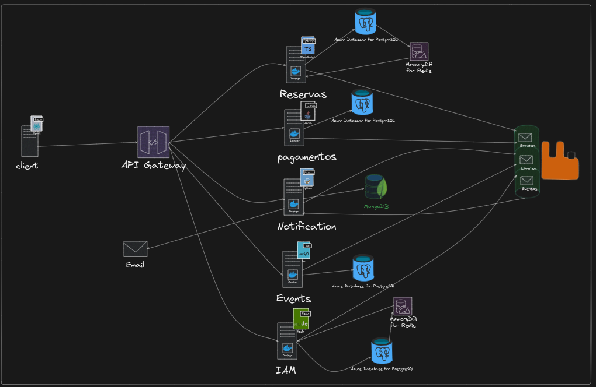

# FlashTicket

A ideia do flash ticket é trabalhar e expor um aprendizado complexo, não só dos conceitos primordiais de microserviços, mas também de padrões arquiteturais, desafios de engenharia de software e trade offs de uma aplicação grande. Quero consguir export aqui todo o fluxo de desenvolvimento e todos os aprendizados que tive nessa joranada, do zero até o domínio dessa arquitetura e entender como resolver os problemas.

## Referências

## Indicações

Aqui no projeto, eu vou escrever um mini blog, dentro da pastinha: '/learn'. Dentro dessa pasta, todos os meus pensamentos, desafios que tive no projeto estão expostos

## Arquitetura do projeto



## Desenvolvimento com Docker

Os serviços `reservations`, `iam` e `payment` montam suas pastas locais nos
containers e recarregam ao detectar alterações. `notifications` é compilado
para uma imagem Go. Para iniciar tudo na raiz:

```bash
docker compose up --build
```

PostgreSQL, Redis, MongoDB, RabbitMQ e Kong continuam usando volumes próprios
para seus dados/configuração; o código-fonte da aplicação não é montado nesses
containers.

O serviço Go de notificações, MongoDB e contrato de eventos estão descritos em
[notifications/README.md](./notifications/README.md). O roteiro local de
aprendizado de Go fica em `docs/teach/golang-basics` e não é versionado.
