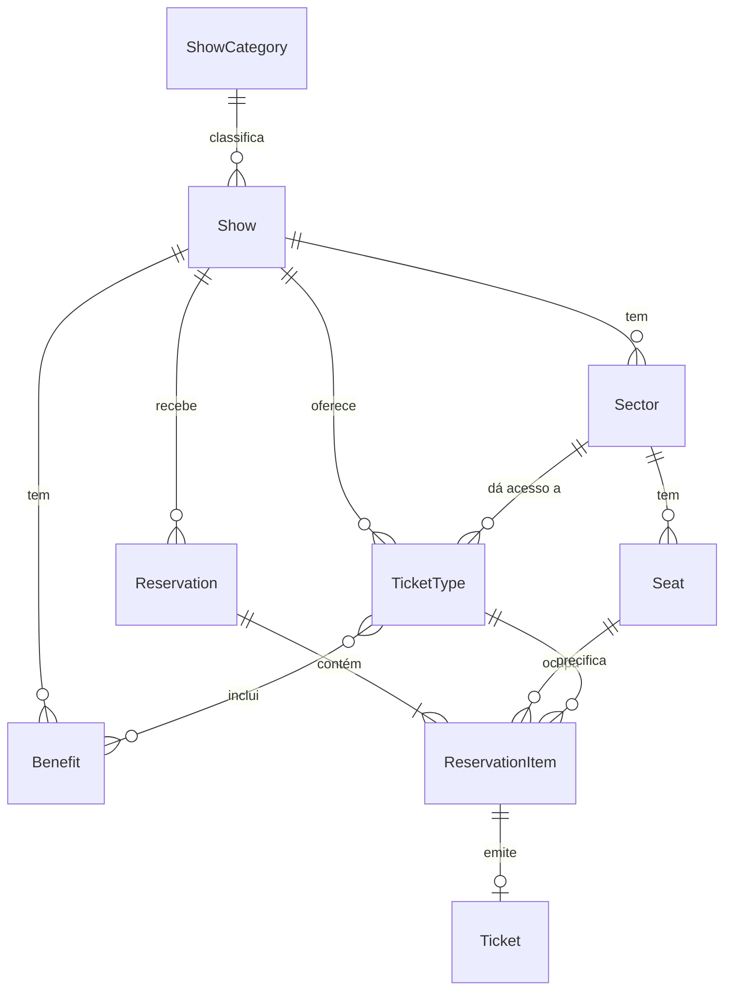
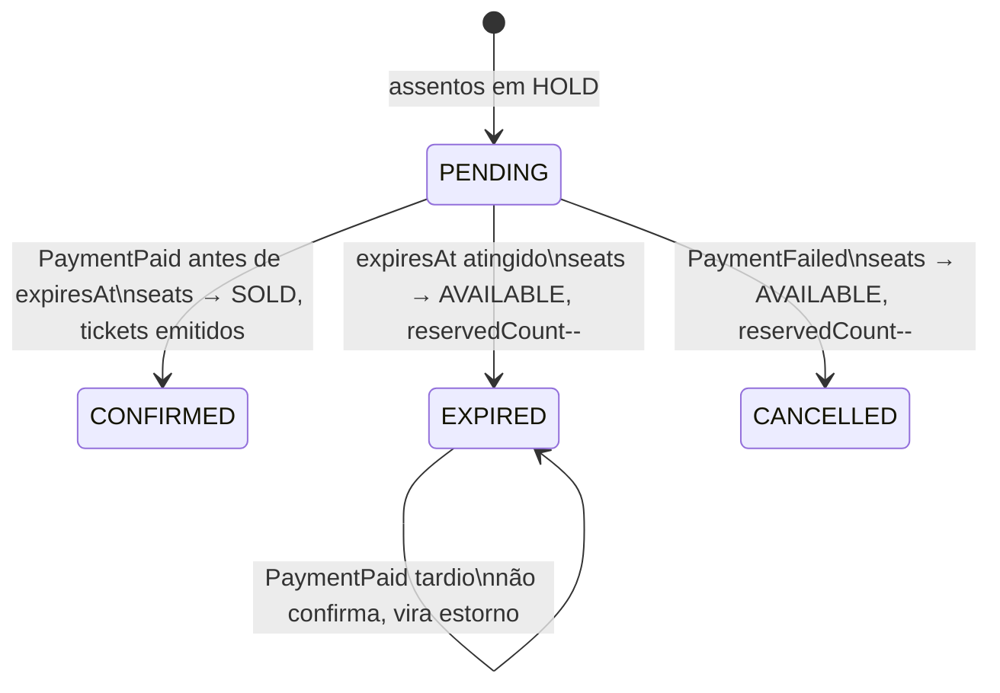

# Reservas — modelo de domínio

Serviço responsável por shows, assentos, reservas e emissão de ingressos.

## Regras de negócio

- **Assento marcado**: todo show tem setores, e cada setor tem assentos (fileira + número).
- **Uma compra, vários ingressos**: o comprador (ex.: um pai com a família de 5 pessoas) reserva vários assentos e paga uma vez só.
  - A reserva é **tudo ou nada**: se um dos assentos não estiver disponível, nada é reservado.
  - O limite é `Show.maxTicketsPerReservation` ingressos por reserva (padrão 6).
- **Reserva ≠ ingresso**: a `Reservation` segura os assentos até `expiresAt`. O `Ticket` só é emitido depois do `PaymentPaid`.
- **Titular por ingresso**: cada ingresso tem nome, documento e data de nascimento do titular. O nome do comprador aparece embaixo.
- **Categoria**: um catálogo gerenciado pelo **root**, com seed inicial (Sertanejo, Gospel, Funk, Clássico, MPB). Também define a classificação etária (`minAge`).
- **Tipo de ingresso** (`TicketType`): um nível de acesso criado pelo **organizador**, por show (Pista, Camarote, Backstage...). Tem preço, setor, cota opcional e benefícios.
- **Meia-entrada**: uma modalidade legal (`PriceModality`: `INTEIRA` | `MEIA`). Vale 50% do preço do tipo e o organizador não pode configurá-la.
- **Coupon**: fica para a próxima leva. Por enquanto, a `Reservation` já tem `couponId` e `discountInCents`.

## Entities

Convenções:
- ids `uuid`, datas `timestamptz` e dinheiro em **centavos (int)**;
- ids de usuário vêm do IAM e ficam **sem FK**, porque o dono desse dado é o IAM.



| Entity | Campos principais |
|---|---|
| `ShowCategory` | `name` (único), `minAge?`, `createdBy?` (null = seed) |
| `Show` | `name`, `description?`, `venue`, `startAt`, `endAt`, `status`, `maxTicketsPerReservation`, `categoryId`, `producerId` |
| `Sector` | `showId`, `name` (único por show) |
| `Seat` | `sectorId`, `row`, `number` (únicos por setor), `status` |
| `TicketType` | `showId`, `sectorId`, `name` (único por show), `priceInCents`, `quantity?`, `reservedCount`, `benefits` |
| `Benefit` | `showId`, `name` (único por show), `description?` |
| `Reservation` | `showId`, `buyerId`, `buyerName`, `status`, `expiresAt`, `discountInCents`, `couponId?`, `totalInCents` |
| `ReservationItem` | `reservationId`, `seatId`, `ticketTypeId`, `priceModality`, `priceInCents`, `holderName`, `holderDocument`, `holderBirthDate` |
| `Ticket` | `reservationItemId` (1:1), `code` (único, vai no QR), `status`, `usedAt?` |

Alguns campos não existem de propósito:
- **Não existe `Show.capacity`**: a capacidade é derivada da contagem de `Seat`. Guardar os dois deixaria os valores divergirem.
- **Existe `TicketType.reservedCount`**, mesmo sendo um dado derivado. Ele permite o hold atômico com `UPDATE` condicional. Um `COUNT(*)` seguido de `INSERT` sofreria race condition.

## Invariantes

Garantidas no banco:
- `endAt > startAt`
- assento único por setor
- nome de tipo, setor e benefício único por show
- `reservedCount <= quantity`
- valores `>= 0`

Garantidas no domínio:
- Só shows `PUBLISHED` e com `startAt` no futuro aceitam reserva.
- Uma reserva tem de 1 a `maxTicketsPerReservation` itens, e tudo nela pertence ao mesmo show.
- O assento do item precisa estar no setor do `TicketType` do item.
- A idade do titular na data `startAt` precisa ser `>= category.minAge`.
- O preço do item é calculado por `ItemPriceCalculator` (a meia arredonda para baixo).
- `totalInCents = Σ itens − discountInCents`.

### Hold atômico (tudo ou nada, em uma transação)

```sql
UPDATE seats SET status = 'HELD'
 WHERE id IN (...) AND status = 'AVAILABLE';          -- precisa afetar N linhas

UPDATE ticket_types SET reserved_count = reserved_count + :n
 WHERE id = :id AND (quantity IS NULL OR reserved_count + :n <= quantity);  -- precisa afetar 1 linha
```

Se qualquer um dos dois afetar menos linhas que o esperado, faz rollback.

## Ciclo de vida da reserva



## Migrations

Ficam em `src/domain/migrations/v1/`.

```bash
yarn migration:generate NomeDaMigration   # gera a partir do diff entities × banco
yarn migration:run
yarn migration:revert
```

## Testes

Os testes unitários ficam em `test/unit/`, organizados para espelhar os módulos
de `src/`. Execute-os com `npm test`; `npm run test:cov` gera a cobertura do
código em `src/`.
